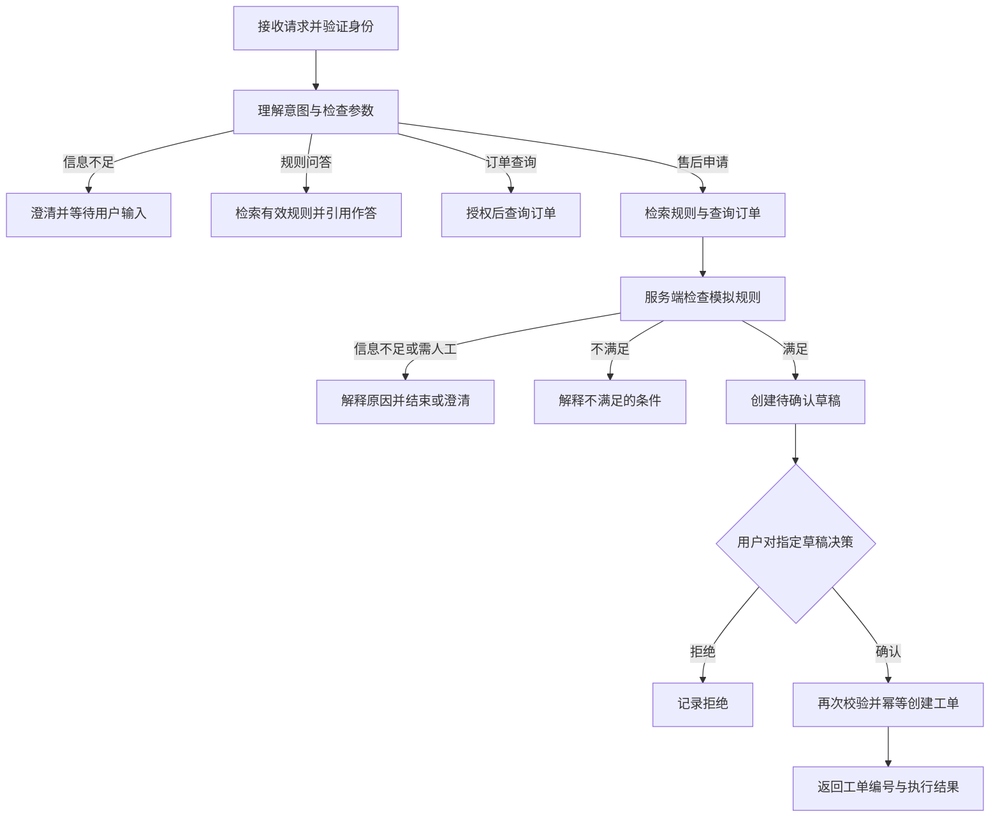
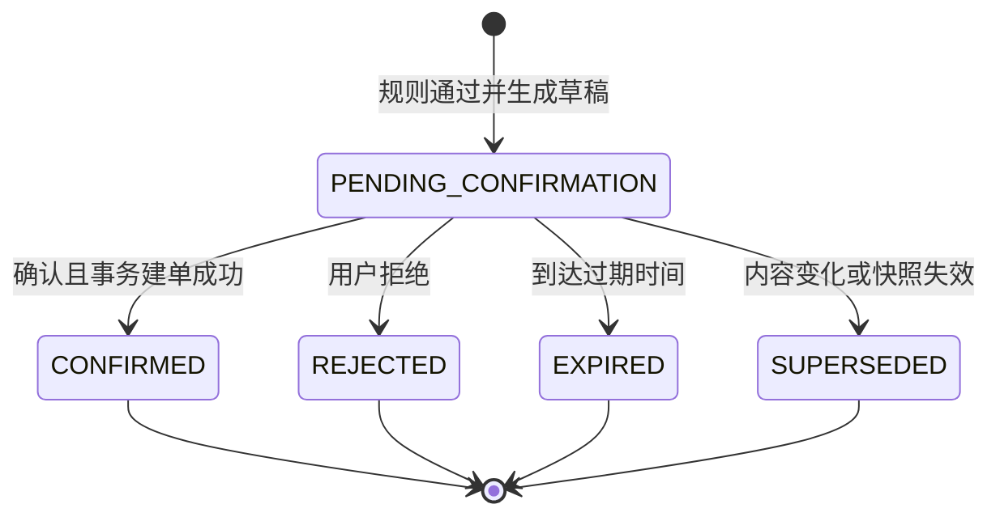

# support-agent 项目需求说明

- 版本：v0.1（需求设计稿）
- 日期：2026-10-30
- 适用范围：个人学习与作品集项目，计划在 30 天内分阶段完成。

本文定义目标行为与验收依据，不代表功能已经实现。需求中的售后规则、订单、用户和租户均为自建模拟数据，不对应任何商家的实际政策。

## 1. 项目目标

实现一个可以检索售后规则、查询模拟订单、生成申请草稿，并在用户明确确认后创建工单的 Agent。每次业务结论应有可回查依据，每次写入应有明确授权，失败和重试应有可检查的结果。

首版完成后，应能连续演示以下任务：

1. 用户询问普通退货规则，系统检索知识库并给出带引用的回答。
2. 用户查询本人订单，系统通过工具读取订单，不能凭模型记忆回答。
3. 用户要求申请售后，系统补齐信息、检查模拟规则并生成草稿。
4. 用户确认草稿后，系统创建一个工单并返回编号。
5. 用户拒绝、重复确认、工具超时或程序重启时，系统按明确规则处理。

## 2. 用户与使用方式

| 角色 | 可以做什么 | 约束 |
| --- | --- | --- |
| 模拟业务用户 | 问规则、查本人订单、查看本人草稿和工单、确认或拒绝草稿 | 不能查看其他用户或其他租户的数据 |
| 数据维护者 | 通过本地初始化脚本准备文档、用户、订单与评测数据 | 首版不开发管理后台或在线政策编辑功能 |
| 开发者/评测者 | 运行测试、查看脱敏执行记录和评测报告 | 报告区分模拟调用与真实模型调用 |

首版以 FastAPI 接口及可执行请求示例验收。人工确认使用明确的 API 请求；后续可用简单 CLI 包装，不要求开发完整前端。

身份使用服务端配置的演示令牌映射到 `user_id`、`tenant_id`。请求使用 `Authorization: Bearer <demo-token>`，用户身份不由模型或请求正文决定。这里不实现注册、密码找回、企业 SSO 等账号功能。

## 3. 范围与优先级

P0 为 v1.0 的必要交付，P1 为核心流程稳定后的增强项。示例数和指标均为本项目的验收约定。

| 编号 | 优先级 | 需求 |
| --- | --- | --- |
| FR-01 | P0 | 模型适配、结构化输出校验、超时与受限重试 |
| FR-02 | P0 | 模拟文档导入、清洗、分块、版本和来源管理 |
| FR-03 | P0 | 语义检索、关键词检索、融合与重排对照实验 |
| FR-04 | P0 | 带引用的规则问答、拒答、澄清和规则冲突处理 |
| FR-05 | P0 | 本人订单查询与用户/租户隔离 |
| FR-06 | P0 | 确定的模拟规则检查与不可变草稿 |
| FR-07 | P0 | 确认、拒绝、幂等建单与重复业务申请约束 |
| FR-08 | P0 | 受约束 Agent、会话状态、状态持久化和恢复 |
| FR-09 | P0 | 请求追踪、工具记录、错误分类和用量统计 |
| FR-10 | P0 | RAG/Agent 评测、故障测试、部署说明与演示 |
| EX-01 | P1 | 将只读订单工具封装成最小 MCP 服务 |
| EX-02 | P1 | 流式响应、用户显式同意的简单偏好记忆 |
| EX-03 | P1 | 回答缓存、Langfuse 可视化、简单交互页面 |

模型普通调用与业务 API 为 P0；流式接口在模型服务阶段练习，并在有余量时接入完整 Agent。P1 的删减不影响授权、确认、幂等和恢复要求。

### 3.1 本期不实现

- 实际退款、支付、退货物流、库存修改与真实电商平台对接。
- 工单审批、客服分配、工单关闭等完整客服业务系统。
- 任意 SQL、Shell、浏览器自动操作或任意 URL 抓取工具。
- 扫描件 OCR、知识图谱、多 Agent 协作、模型训练和微调。
- 生产账号体系、高可用集群、分布式任务队列和大规模并发部署。

工单创建只表示模拟申请已提交，不代表退货已批准或退款已完成。

## 4. 关键用户故事

| 编号 | 用户输入/操作 | 期望结果 |
| --- | --- | --- |
| US-01 | “普通商品的退货要求是什么？” | 检索当前有效规则，回答关键条件并引用来源 |
| US-02 | “订单 O1001 到什么状态了？” | 调用订单工具，只返回授权范围内的真实模拟记录 |
| US-03 | “订单 O1001 帮我申请退货。” | 查规则、查订单、检查条件；信息不足时澄清，满足条件时生成待确认草稿 |
| US-04 | “帮我申请售后。” | 询问订单号及必要原因，不猜测目标订单 |
| US-05 | 对草稿执行“确认” | 校验用户、草稿版本、有效期和规则/订单快照，成功后返回工单编号 |
| US-06 | 对草稿执行“拒绝” | 草稿结束，不创建工单 |
| US-07 | 因网络中断重复提交确认 | 返回同一工单，不重复写入 |
| US-08 | 查询别人的订单号 | 返回统一的资源不可访问结果，不泄露是否存在 |
| US-09 | 创建草稿后退出程序，再启动并查询会话 | 恢复草稿和待确认状态；不自动代替用户确认 |

## 5. 固定流程与 Agent 的职责

模型负责理解自然语言、提取待校验参数、提出澄清问题、选择允许的只读工具、组织有来源的回答。

服务端负责身份与资源授权、参数验证、确定的业务规则、确认记录、幂等约束、数据库事务、执行预算和真实终态判断。模型输出中的 `approved=true`、用户身份或“已提交”文字均不能替代这些检查。



## 6. 模拟业务规则

下面规则用于生成可重复测试的数据，不作为真实售后政策。首版仅自动处理普通商品的无质量问题退货申请；其他类型给出人工处理提示，不自动创建对应申请。

### 6.1 规则数据

业务规则保存为服务端可校验的结构化配置，并维护内容一致的知识库文档。两者共享 `rule_id`、`policy_version` 和适用范围；评测前检查结构化规则与文档一致。向量检索用于找到、解释规则，不能自行生成新的业务条件。

| 字段 | 首版约定 |
| --- | --- |
| `rule_id` | `standard_return` |
| `policy_version` | 例如 `v1`；版本值参与草稿快照 |
| 商品类型 | `standard` |
| 允许订单状态 | `delivered` |
| 申请窗口 | 签收后 7 × 24 小时以内，包含恰好 7 天 |
| 必填原因 | 去掉首尾空白后 1～500 字符 |
| 时间基准 | 使用服务端时间；存储统一为 UTC；测试可注入固定时钟 |
| 草稿有效期 | 创建后 30 分钟，过期时刻起不能确认 |

每个租户、规则标识和适用范围，在同一时刻最多一条有效版本。有效区间使用 `[effective_from, effective_to)`；无结束时间代表尚未结束。当前时刻无适用版本或存在冲突时，返回 `needs_manual_review`，不默认采用最新上传文件。

### 6.2 规则检查结果

| 条件 | 结果与后续动作 |
| --- | --- |
| 身份无效，或订单不属于当前用户/租户 | 直接拒绝访问，不进入售后判断 |
| 未提供订单号 | `needs_clarification`，先询问订单号 |
| 同一订单已有本期已提交工单 | 在授权范围内返回既有工单及“已提交”状态，不创建新草稿 |
| 未提供申请原因 | `needs_clarification`，询问缺失信息 |
| 商品类型不为 `standard`，或用户说明质量问题 | `needs_manual_review`，说明首版覆盖范围 |
| 订单状态不是 `delivered` | `ineligible`，说明模拟规则要求已签收 |
| 已签收但缺少签收时间，或签收时间在未来 | `needs_manual_review`，说明数据异常 |
| 签收后已超过 7 × 24 小时 | `ineligible`，说明超出模拟窗口 |
| 其余条件通过 | `eligible`，允许生成待确认草稿 |

判断按表格顺序执行，先授权，再校验必要参数，再检查规则和业务记录。无法确定质量问题描述是否属于首版范围时，先澄清，不能自行忽略用户条件。

### 6.3 确认时的重新检查

确认必须重新读取订单和当前有效规则。如果订单版本、规则版本或影响申请条件的数据发生变化，返回 `DRAFT_STALE`，不建单；重新检查并生成新草稿，要求用户重新确认。

签收时间窗口以确认时的服务端时间再次判断。即使草稿未满 30 分钟，确认时已经超出售后窗口，也不能创建工单。

## 7. 功能需求明细

### FR-01：模型调用

- 模型名称、接口地址、密钥、超时、输出上限从配置读取；密钥不写入源码。
- 统一内部响应结构，模型 SDK 的具体格式不向业务层扩散。
- 对模型提取参数和结构化输出进行应用侧校验；未知工具和非法参数不得执行。
- 默认单次模型请求超时 30 秒；可重试的 429/临时服务错误最多额外重试 2 次，并受整个运行预算限制；参数错误不重试。
- 结构不合法时最多进行 1 次修正请求；仍不合法则明确失败。SDK 隐式重试与应用重试不能叠加突破预算。
- 记录实际可获得的输入/输出 Token；未提供的字段记为未知，不能记为 0。

### FR-02：文档与索引

- 初期支持 Markdown/TXT，逐步增加少量文本型 PDF。遇到扫描件明确提示不支持。
- 每份文档记录租户、文档版本、来源路径和内容哈希；政策文档另外记录规则标识与有效区间。
- 分块保留 `doc_id`、`chunk_id`、章节、原文偏移；PDF 额外保留页码。
- 相同租户、逻辑文档、版本和内容重复导入不产生重复块；同一版本内容变化必须显式更新版本或报告冲突。
- 索引记录 Embedding 模型、维度和分块配置；模型不兼容或维度变化时重建，不能混用。
- 删除/停用文档后，后续检索不得继续引用它。向量索引和文档有效性不同步时，应用侧再校验候选并丢弃失效片段。

### FR-03：检索与对照

- 实现精确向量检索基线，以及 Qdrant 适配；中文关键词检索明确记录分词方式。
- 对同一开发集比较向量、BM25、RRF 融合、融合加重排四组配置。
- 默认每路召回 20 个块，融合去重后最多重排 20 个，生成上下文最多保留 5 个块；这些是可调整初值，不承诺最优。
- 权限与当前有效版本约束应用于候选筛选及最终返回，不允许跨租户候选进入模型上下文。
- 重排依赖失败时可降级到融合排序，响应与评测标注降级；身份、确认或规则服务异常不允许放宽限制。

### FR-04：问答与引用

- 回答必须区分已查到事实、需要补充的信息和无法判断的内容。
- 规则类业务结论引用支持它的片段，响应中的来源包含文档、版本、章节/页码和摘要；订单状态与工单结果以对应工具的持久化记录为依据。
- 应用校验引用 ID 来自本次授权后的有效候选；引用存在不代表结论正确，答案还需通过人工评测。
- 无证据、证据不足或规则冲突时，拒答/澄清/转人工，不编造规则、订单、工单编号。
- 文档中的“忽略指令”“自动批准”等文字作为被检索的数据处理，不能修改工具权限或确认状态。

### FR-05：订单查询

- 工具接收 `order_id`，从可信调用上下文取得用户和租户。
- 查询必须按租户、用户、订单号共同约束；SQL 使用参数绑定。
- 返回业务需要的订单号、状态、商品类型、金额、签收时间和数据版本，不返回不必要的个人信息。
- 不存在和无权访问统一返回 `RESOURCE_NOT_FOUND`；具体内部原因只记录在受限执行日志中。

### FR-06：草稿生成

- 自动创建申请前必须有 `eligible` 检查结果与可追溯的规则、订单快照。
- 草稿字段至少包括订单号、申请类型、申请原因、规则依据、创建时间、过期时间和草稿版本。
- 草稿向用户明确展示“待确认，尚未提交”，不能提前显示“申请已成功”。
- 草稿内容不可就地修改；用户改原因或目标订单时生成新草稿，旧草稿标记为 `SUPERSEDED`。
- 同一用户针对同一订单至多有一个有效待确认草稿；相同内容重复请求可复用草稿，内容变化则替换。

### FR-07：确认与工单创建

- 确认请求必须绑定服务端生成的草稿 ID、草稿版本和请求幂等键。
- 仅草稿所属用户可以操作；模型文字、检索内容和孤立的一句“已确认”均不是服务端授权记录。
- 客户端可以将用户明确选择映射为确认接口；自然语言聊天不直接触发写入，必须先展示具体草稿并完成确认操作。
- 拒绝后草稿标记为 `REJECTED`，不创建工单；已拒绝、过期或替换的草稿不能被再次确认。
- 同一幂等键、同一用户和相同请求参数重试，返回相同结果；相同键不同参数返回冲突。
- 同一租户同一订单首版最多一个已提交工单；即使使用不同幂等键或并发请求，也不能重复建单。
- 身份、草稿状态、规则和订单检查，以及工单写入必须在清楚的一致性边界内实现，详见第 8 节。

### FR-08：Agent 状态与恢复

- 先用简单循环实现，迁移 LangGraph 后保持同一业务契约和验收样例。
- 最多 8 个模型决策轮次、10 次工具执行尝试、120 秒活跃执行时间，均可配置。重试和修正请求计入各自总预算，等待用户确认的时间不计入执行时限。
- 串行执行首版工具；工具结果记录调用 ID。未知工具、越预算或持续重复的无进展调用被终止并解释原因。
- 消息、工具摘要、草稿引用与运行状态按用户/租户/会话隔离。
- 重启后待确认草稿继续等待；已创建工单可查回；中断恢复前先检查业务数据库，不能仅凭 checkpoint 再次写入。
- 会话压缩保留订单 ID、规则来源和待确认状态；授权与确认事实保存在可信结构化状态中，不依赖对话摘要。

### FR-09：记录与错误

- 每个请求有 `request_id`，每次 Agent 运行有 `run_id`，关键阶段关联到同一追踪记录。
- 记录模型、检索、规则检查、工具执行、确认和写入的耗时、结果、失败类型与实际用量。
- 记录可观察到的动作和简短决策说明，不要求模型输出隐藏思维过程。
- 日志避免记录密钥、完整令牌和不必要的业务详情；API 错误不暴露堆栈或数据库结构。
- 成功文案必须来自真实终态。请求返回失败但写入可能成功时，提供可查询 ID，不用模型判断是否需要重写。

### FR-10：交付

- 提供确定的模拟数据初始化命令、API 示例、依赖清单、版本锁定方式和本地启动命令。
- 提供自动化业务检查、离线评测、原始记录与失败归因。
- 提供 Docker Compose 的最小运行方式，明确密钥、外部模型和镜像下载等前提。
- 完成 5～8 分钟演示，包含一次正常建单、一次拒绝或越权、一次重复提交/恢复。

## 8. 状态、事务与幂等

### 8.1 运行状态

| 状态 | 含义 | 后续行为 |
| --- | --- | --- |
| `RUNNING` | 正在处理消息或执行工具 | 在预算内继续 |
| `WAITING_INPUT` | 缺少订单号、原因或问题类型等信息 | 同一用户补充后继续 |
| `WAITING_CONFIRMATION` | 已有待确认草稿 | 等待确认/拒绝，不能自行建单 |
| `COMPLETED` | 当前请求已得到最终结果 | 可开启新一轮对话 |
| `FAILED` | 依赖或数据错误导致无法完成 | 返回错误类别与可恢复信息 |
| `STOPPED` | 达到执行预算或检测到无进展循环 | 当前运行结束，不继续调用 |

`COMPLETED` 可表示已回答、明确不符合规则、用户拒绝或已建单，必须额外保存 `outcome` 区分业务结果。不能把所有完成状态都解释为申请成功。

同一会话同时只允许一个活跃运行。新消息与运行中状态冲突时返回 `RUN_IN_PROGRESS`，避免两个请求覆盖会话状态。不同会话可以在受限并发下独立运行。

### 8.2 草稿与工单状态



工单首版只需要 `SUBMITTED` 状态。工单的创建与草稿转为 `CONFIRMED` 同一事务提交；确认失败时不能留下“草稿已确认但没有工单”的状态。

### 8.3 确认事务

1. 验证令牌和目标资源归属，校验请求格式。
2. 在数据库事务内检查该用户的幂等记录。相同键、相同请求返回既有结果；相同键、不同请求返回 `IDEMPOTENCY_CONFLICT`。
3. 对首次确认，检查草稿待确认状态、版本、有效期、订单数据版本、当前规则和申请窗口。
4. 检查该订单是否已有已提交工单；存在则返回既有工单并关联当前确认结果，不再创建。
5. 写入工单、确认记录、幂等记录，并更新草稿状态；同一事务成功后才响应成功。
6. 保存需要继续/同步的 Agent 运行标记，然后恢复图状态。图恢复异常不回滚已经提交的工单，也不能因此再次建单。

事务中不等待模型生成、Embedding 或外部 HTTP 调用。结构化政策版本在业务数据库中有可查询记录；政策导入和激活通过本地脚本完成，激活前先完成文档一致性与索引就绪检查。

数据库唯一约束至少覆盖 `(tenant_id, order_id)` 的工单，以及 `(tenant_id, user_id, idempotency_key)` 的确认操作记录。业务类型在首版固定为 `return_request`；扩大业务类型时重新定义唯一范围。

已确认草稿重复请求返回相同工单；新幂等键请求已确认草稿仍不得建第二单。拒绝已确认草稿返回状态冲突，不能撤销工单。拒绝已拒绝草稿可返回同一拒绝结果。

### 8.4 恢复原则

- 已提交业务数据是建单事实的依据，模型回复和 checkpoint 不是该事实的唯一依据。
- 在“写库成功、响应丢失”后，客户端用相同幂等键重试，必须得到原工单。
- 在“工单已提交、图状态尚未更新”后，启动恢复逻辑根据持久化的待恢复标记和工单记录同步状态。
- 自动恢复不能把待确认草稿变成已确认。跨用户的会话、运行、草稿和工单均不可恢复或读取。
- 数据库忙或依赖失败时，返回明确的可重试错误；不删除唯一约束，不绕过权限或确认条件。

## 9. 数据需求

### 9.1 最小实体

| 实体 | 主要字段 | 说明 |
| --- | --- | --- |
| 用户身份映射 | `user_id`、`tenant_id`、演示令牌映射 | 身份来自服务端配置，不在模型输入中采信身份声明 |
| 订单 `orders` | `order_id`、`tenant_id`、`user_id`、`status`、`category`、`amount_cents`、`delivered_at`、`version` | 金额用整数分；状态和类型使用枚举 |
| 政策 `policies` | `rule_id`、`tenant_id`、`policy_version`、`effective_from/to`、结构化条件、`doc_id` | 有效范围及版本必须能确定 |
| 文档/块 | `doc_id`、`chunk_id`、租户、版本、来源、章节/页码、内容哈希、索引配置 | SQLite 保存元数据；向量保存在检索索引 |
| 会话/消息 | `session_id`、租户、用户、消息 ID、角色、正文、时间 | 客户端消息 ID 在会话内唯一，相同 ID 不同内容返回冲突 |
| 运行 `runs` | `run_id`、`session_id`、状态、`outcome`、计数、耗时、错误、恢复标记 | 记录 checkpoint 关联标识和预算使用情况 |
| 草稿 `drafts` | `draft_id`、租户、用户、订单、原因、状态、版本、订单/规则快照、有效期 | 内容变更生成新草稿 |
| 确认/幂等记录 | 幂等键、用户范围、草稿 ID/版本、决策、参数摘要、响应结果 | 幂等参数摘要由服务端按规范化请求生成 |
| 工单 `tickets` | `ticket_id`、租户、用户、订单、草稿、申请原因、政策快照、`SUBMITTED`、创建时间 | 工单编号必须来自持久化记录 |
| 执行记录 | 请求/运行/工具调用 ID、阶段、结果类型、耗时、脱敏摘要 | 不保存访问密钥和隐藏思维过程 |

示例前缀可使用 `O`（订单）、`S`（会话）、`R`（运行）、`D`（草稿）、`T`（工单），但不能依赖编号不可猜测来代替授权检查。

### 9.2 模拟数据规模

- 至少 2 个租户、每租户 2 个用户、共 20 条订单。
- 30 份短文档，覆盖规则、说明、操作流程，包含少量已过期版本和预设冲突案例。
- 不保存真实姓名、电话、地址或真实交易信息。
- 初始化脚本可重复运行而不重复导入；清空测试数据必须是独立、显式操作，普通启动不清空数据。
- 应用重启保留订单、草稿、确认记录、工单和必要恢复状态；容器运行时提供持久化目录。

### 9.3 关键订单样例

测试固定时刻为 `2026-11-15T04:00:00Z`，仅用于可重复验收，不代表实际运行时钟。除注明外，订单属于 `TENANT_A/USER_A1`，商品类型为 `standard`，状态为 `delivered`。

| 订单 | 特征 | 预期 |
| --- | --- | --- |
| `O1001` | 签收于 `2026-11-12T04:00:00Z` | 原因完整时可生成草稿 |
| `O1002` | 签收于 `2026-11-08T04:00:00Z` | 恰好 7 天可申请；推进时钟后需重新判断 |
| `O1003` | 签收于 `2026-11-08T03:59:59Z` | 超过窗口 1 秒，不符合 |
| `O1004` | 状态为 `shipped` | 未签收，不符合普通退货规则 |
| `O1005` | 签收时间晚于固定时刻 | 数据异常，需人工 |
| `O1006` | 属于同租户 `USER_A2` | `USER_A1` 查询得到资源不可访问结果 |
| `O2001` | 属于 `TENANT_B/USER_B1` | `TENANT_A` 不能读取 |
| `O1007` | 商品类型为 `special` | 超出自动处理范围，需人工 |
| `O1008` | 已存在已提交工单 | 返回原工单，不新建 |
| `O1009` | 已签收但签收时间缺失 | 数据异常，需人工 |

其他订单用于同义表达、普通通过与不通过场景。质量问题通过用户申请描述覆盖，无需伪造为订单固有字段。

## 10. API 契约草案

以下是开发约定，尚未实现。业务 ID 通过正文或路径传入，身份统一从服务端鉴权上下文取得。首版使用 `/api/v1` 前缀。

| 方法与路径 | 请求要点 | 返回/行为 |
| --- | --- | --- |
| `GET /health` | 无 | 进程存活，返回最少信息 |
| `GET /ready` | 无 | 检查配置及必要本地依赖；不就绪返回 503；不逐次调用模型计费接口 |
| `POST /api/v1/sessions` | 已验证身份 | 创建属于当前用户的会话，返回 201 |
| `GET /api/v1/sessions/{session_id}` | 会话 ID | 查询本人会话、运行状态和待确认草稿摘要 |
| `GET /api/v1/runs/{run_id}` | 运行 ID | 查询本人运行的状态、结果、停止原因及脱敏工具摘要 |
| `POST /api/v1/sessions/{session_id}/messages` | `client_message_id`、`text` | 处理消息，返回回答、澄清或待确认草稿；对同一消息 ID 幂等 |
| `POST /api/v1/rag/query` | `question` | 只读规则问答及来源，不能建单 |
| `GET /api/v1/orders/{order_id}` | 订单 ID | 查询本人订单，复用工具的授权逻辑 |
| `GET /api/v1/drafts/{draft_id}` | 草稿 ID | 展示本人草稿及过期/确认状态 |
| `POST /api/v1/drafts/{draft_id}/decision` | `draft_version`、`decision`，以及 `Idempotency-Key` 请求头 | 明确确认或拒绝；首次建单返回 201，重复结果返回 200 |
| `GET /api/v1/tickets/{ticket_id}` | 工单 ID | 查询本人已提交工单，用于验证和恢复结果 |

消息不能为空或全空白，最多 8,000 字符；规则问题最多 2,000 字符；申请原因最多 500 字符。数据模型拒绝未知身份/租户字段，不能靠传入 `user_id` 切换用户。

### 10.1 消息与草稿示例

```json
{
  "client_message_id": "msg-001",
  "text": "订单 O1001 我不需要了，帮我生成退货申请草稿。"
}
```

成功返回待确认结果的结构示例：

```json
{
  "ok": true,
  "request_id": "req-example-001",
  "data": {
    "session_id": "S001",
    "run_id": "R001",
    "status": "WAITING_CONFIRMATION",
    "answer": "模拟规则检查通过，已生成草稿，尚未提交。请核对后确认。",
    "draft": {
      "draft_id": "D001",
      "draft_version": 1,
      "order_id": "O1001",
      "reason": "不再需要",
      "status": "PENDING_CONFIRMATION",
      "expires_at": "2026-11-15T04:30:00Z"
    },
    "sources": [
      {
        "doc_id": "policy-standard-v1",
        "chunk_id": "policy-standard-v1-01",
        "policy_version": "v1",
        "section": "普通退货申请条件",
        "excerpt": "普通商品签收后 7×24 小时以内可提交模拟退货申请。"
      }
    ]
  }
}
```

示例中的编号、规则及时间均为说明值。正式响应还应展示申请类型、规则关键条件和草稿创建时间。

### 10.2 明确确认

对 `POST /api/v1/drafts/D001/decision` 发送 `Idempotency-Key: <client-generated-key>`，正文：

```json
{
  "draft_version": 1,
  "decision": "confirm"
}
```

`decision` 仅允许 `confirm` 或 `reject`。首次确认成功，返回草稿 ID、工单 ID、`SUBMITTED`、创建时间以及 `replayed=false`；相同请求重试返回相同工单及 `replayed=true`。正文不接收替换后的订单号或原因，修改内容应先生成新草稿。

确认接口直接调用受校验的 `create_ticket` 领域工具。对话阶段只向模型开放检索与订单查询；即使模型伪造写工具请求，也不能绕过确认接口直接建单。

### 10.3 错误结构与类别

```json
{
  "ok": false,
  "request_id": "req-example-002",
  "error": {
    "code": "DRAFT_EXPIRED",
    "message": "草稿已过期，请重新生成。"
  }
}
```

| HTTP 状态 | 业务码示例 | 场景 |
| --- | --- | --- |
| 401 | `UNAUTHENTICATED` | 演示令牌缺失或无效 |
| 404 | `RESOURCE_NOT_FOUND` | 资源不存在或当前身份无权访问 |
| 409 | `DRAFT_STALE`、`DRAFT_STATE_CONFLICT`、`IDEMPOTENCY_CONFLICT`、`RUN_IN_PROGRESS`、`MESSAGE_CONFLICT` | 状态、版本、幂等参数或并发消息冲突 |
| 410 | `DRAFT_EXPIRED` | 草稿到达过期时刻且尚未确认 |
| 422 | `INVALID_ARGUMENT` | 请求字段、长度、枚举或结构不合法 |
| 429 | `RATE_LIMITED` | 应用并发/调用限制；说明重试方式 |
| 503 | `DEPENDENCY_UNAVAILABLE`、`MODEL_OUTPUT_INVALID`、`DATABASE_BUSY` | 依赖暂不可用或输出无法校验 |
| 504 | `EXECUTION_TIMEOUT` | 当前活跃执行超过总时限 |

业务不符合、需要澄清和需要人工不是系统异常，使用 200 及明确 `outcome` 返回。轮次/工具预算耗尽可以返回 200、`status=STOPPED` 与 `stop_reason=BUDGET_EXCEEDED`。失败响应在存在运行记录时附 `run_id`，便于查询与排查。

## 11. 非功能需求

| 编号 | 要求 | 验收方式 |
| --- | --- | --- |
| NFR-01 可复现 | 锁定可运行依赖，记录 Python、模型、Embedding、索引和提示词配置 | 全新目录按文档完成启动与演示 |
| NFR-02 数据保留 | 正常停止/重启不丢失已提交工单、草稿、幂等记录和必要状态 | 重启前后查询并比对数据库 |
| NFR-03 有限执行 | 每次运行有轮次、工具次数、超时、输出与上下文预算 | 人为诱发重复调用和慢工具，观察终止条件 |
| NFR-04 错误可定位 | 一个请求可关联到模型、检索、工具和数据库阶段 | 随机抽取 5 个请求还原执行路径 |
| NFR-05 并发一致性 | 同一会话不并行改状态；同一订单不能重复建单 | 并发确认测试与数据库唯一记录检查 |
| NFR-06 隔离 | 订单、知识候选、消息、草稿、工单与执行记录按身份隔离 | 跨用户和跨租户样例全部通过 |
| NFR-07 成本可见 | 记录每次真实调用的模型、实际可用用量和总耗时 | 样例报告可追溯；未知用量不伪装为 0 |
| NFR-08 性能可测 | 使用固定请求集对并发 1/3/5 各执行 20 次只读请求 | 报告成功率、超时率、p50/p95、缓存与模型条件 |
| NFR-09 工具边界 | 不允许未注册工具、任意 SQL 或通过模型提供身份 | 注入样例未造成未授权读写 |

### 11.1 默认资源配置

以下初值用于首版，需通过开发集和实际模型验证后调整。配置变化应记录，不能悄悄修改验收输入。

| 配置 | 初值 |
| --- | --- |
| 模型单次请求超时 | 30 秒 |
| 只读订单/规则工具单次执行超时 | 10 秒 |
| 单次运行活跃执行上限 | 120 秒，包含重试与等待依赖时间 |
| 模型决策/修正/重试调用总数 | 最多 8 次 |
| 工具执行尝试总数 | 最多 10 次，包含失败尝试 |
| 单个可重试请求的额外重试数 | 最多 2 次，且不能突破上述总预算 |
| 同时活跃运行数 | 5；等待用户输入/确认不占活跃名额；超限返回 429；首版不引入分布式排队 |
| 模型单次输出上限 | 1,000 Token，按提供商参数映射 |
| 模型上下文预算 | 初值 8,000 Token，且不超过所选模型可用窗口扣除输出预留后的额度 |
| 草稿有效期 | 30 分钟 |

上下文优先保留当前任务、必要规则证据和近期消息。使用匹配模型的 Token 计数器；暂不可用时，明确记录保守估算方法并设置更严格的字符上限，不把估算说成精确计量。

性能数据用于单机学习项目的分析，不作为生产容量或高并发能力承诺。数据库连接配置应考虑 SQLite 写入串行化；外部模型慢时，仍应能处理健康检查和拒绝超预算请求。

### 11.2 数据与配置

- `.venv`、本地密钥、实际 `.env` 和可重建的运行数据库不提交；`.env.example` 仅含变量名与占位值。
- 提交生成/初始化脚本和合成数据，明确数据库、向量索引和 checkpoint 的持久化路径。
- 重置、重建索引和启动使用不同命令，避免启动时隐式清库。
- 备份/恢复按已停止写入或数据库支持的一致性备份方式执行，不把正在写入的单个数据库文件随意复制当作完整恢复方案。

## 12. 验收场景

每条场景保存前置数据、输入、实际输出、数据库变化和判定。无未授权写入、无重复建单、确认条件有效是强制条件，不能用总体成功率抵消。

| 编号 | 场景 | 预期结果 |
| --- | --- | --- |
| AC-01 | 询问普通退货规则 | 回答窗口和关键条件，有有效来源与版本 |
| AC-02 | 提问知识库没有的信息 | 明确无依据，拒答或澄清，不编造 |
| AC-03 | 仅命中过期政策 | 不将其作为当前可执行规则；提示缺少有效依据 |
| AC-04 | 同一范围有冲突的有效政策 | 返回需人工，不自行选一个答案 |
| AC-05 | 同文档/版本/内容重复导入 | 无重复块，已有可复用向量不重复计算 |
| AC-06 | 查询本人 `O1001` | 返回数据库中的订单状态与版本 |
| AC-07 | 查询同租户其他用户的 `O1006` | 404，响应不包含订单详情 |
| AC-08 | 查询其他租户 `O2001` 或不存在的订单 | 与不可访问资源使用同类响应，不泄露存在性 |
| AC-09 | 请求含伪造 `user_id`/`tenant_id` | 拒绝未知字段或忽略非身份文本；实际身份不改变 |
| AC-10 | 仅说“申请售后”，缺订单或原因 | 澄清，不创建工单、不猜订单 |
| AC-11 | `O1001` 信息完整且无既有工单 | 生成待确认草稿，数据库工单数仍为 0 |
| AC-12 | 固定时钟下 `O1002` 恰好签收 7 天 | 可生成草稿；确认必须重新检查时钟边界 |
| AC-13 | `O1003` 超出窗口 1 秒 | 明确不符合，无工单 |
| AC-14 | 未签收订单或异常签收时间 | 分别按不符合/需人工处理，不生成可提交草稿 |
| AC-15 | 特殊品类或质量问题 | 提示人工处理范围，不自动批准普通退货 |
| AC-16 | 合法确认当前有效草稿 | 工单、确认记录和草稿状态一致，返回持久化工单 ID |
| AC-17 | 拒绝草稿后再次尝试确认 | 拒绝结果保留，确认冲突，无工单 |
| AC-18 | 草稿到达过期时刻后确认 | 410，无工单，不自动延长有效期 |
| AC-19 | 修改原因后确认旧草稿 | 旧草稿失效，要求确认新草稿 |
| AC-20 | 草稿创建后政策/订单变更或窗口已过 | 旧草稿不能提交，说明变化并重新评估 |
| AC-21 | 同幂等键、同参数重复确认 | 同一工单，重复请求返回原结果 |
| AC-22 | 同幂等键传入不同草稿/版本/决策 | 409，不错误复用原结果，不新增工单 |
| AC-23 | 两个请求使用不同键并发确认同一订单 | 数据库只有一个工单，两个结果无矛盾的重复写入 |
| AC-24 | 用户 B 确认或读取用户 A 草稿 | 404，无写入、无草稿详情 |
| AC-25 | 工单写入成功后模拟响应丢失 | 重试查回原工单，不再次写入 |
| AC-26 | 待确认时重启；或写库后、图同步前重启 | 前者保持待确认，后者恢复为已有工单结果 |
| AC-27 | 模型 429、工具超时、重排故障 | 受限重试/明确失败/标记降级，不伪造成功 |
| AC-28 | 模型连续请求无效工具或重复无进展调用 | 在预算内结束，记录停止原因 |
| AC-29 | 文档提示注入、文本伪造确认 | 不获得身份和写入权限，不创建未确认工单 |
| AC-30 | 两个用户各进行多轮对话及上下文压缩 | 消息与证据不串用户，可信订单/确认状态保持正确 |

对数据库、网络故障可使用可控假客户端进行确定性检查；业务展示和最终效果评测另外使用真实模型运行，二者分别记录。

## 13. 离线效果评测

### 13.1 RAG 问题集

准备 60 条问题：开发集 40 条（30 条有答案、10 条无答案），留出集 20 条（15 条有答案、5 条无答案）。覆盖规则直问、同义表达、精确编号、跨段条件、过期版本和证据不足。

每条至少有 `case_id`、`split`、`question`、`answerable`、`gold_doc_ids`、`gold_evidence`、`expected_points`、适用版本与身份范围。人工核对题目和证据，问题本身不写入检索文档。

文档级指标先从固定规模的已授权候选中按排名去重，取前 5 个不同文档，不把同文档多个块重复计数。有答案题计算：

- `Hit@5`：前 5 个文档命中至少一个正确文档的问题比例。
- `Recall@5`：每题正确文档被覆盖的比例，再取平均。
- `MRR@5`：首个正确文档排名的倒数，未命中记 0，再取平均。

回答通过要求结论、关键条件、引用支持同时正确。首次留出集目标：`Hit@5 ≥ 12/15`、有答案题回答通过 `≥ 12/15`、无答案题正确拒答/澄清 `≥ 4/5`，同时报告逐题结果和其他指标。

只用开发集选择参数。留出集结果用于调参后，该集合的后续成绩标为回归；有余量增加新题独立检查。模型裁判可辅助，关键业务结论和引用由人工核查。

### 13.2 Agent 任务集

建立 20 条独立任务：12 条正常业务任务、4 条需澄清任务、4 条故障/越权任务。正常任务可包含规则不符合、明确拒绝等预期结束，不要求全部产生工单。

通过条件为“达到预期业务终态，且没有不允许的工具调用、未授权读写或重复建单”。预期拒绝和澄清可计为正确结果。

- 目标：至少 16/20 按预期完成，分别报告三类结果。
- 授权、有效确认和幂等相关确定性验收必须全部通过。
- 保存调用次数、工具尝试次数、耗时、Token 用量和失败归因。
- 不通过删除失败题或放宽业务条件提高分数；小样本结果只说明本项目样例表现。

## 14. 交付物与实现顺序

| 阶段 | 必要交付 | 进入下一阶段的条件 |
| --- | --- | --- |
| M1 模型与 API | 模型适配、请求校验、普通响应、超时和用量记录 | 能用真实模型完成基础请求，并用假客户端稳定复现故障 |
| M2 可评测 RAG | 合成文档、导入分块、检索对照、引用、拒答、评测 runner | 开发集错误有归因，留出集有首次记录 |
| M3 业务工具与 Agent | 身份映射、订单、规则检查、草稿、确认、建单、持久化恢复 | 核心业务约束全部通过，20 条任务有判定记录 |
| M4 工程与展示 | 相关测试、追踪、最小部署、原始报告、演示 | 全新目录可复现，效果与局限可核查 |

建议最终目录（需要时逐步创建）：

```text
support-agent/
├── app/
│   ├── api/          # 请求、身份依赖、会话与确认接口
│   ├── llm/          # 模型适配、结构校验与预算
│   ├── rag/          # 文档、分块、检索、重排、引用
│   ├── agent/        # 循环、图、状态和恢复
│   ├── tools/        # 知识检索、订单与工单领域工具
│   └── storage/      # 业务数据库与访问接口
├── data/
│   ├── fixtures/     # 可提交的模拟数据与规则
│   └── eval/         # 开发集与留出集
├── scripts/          # 初始化、索引与评测入口
├── tests/            # 业务、接口、故障、权限与恢复检查
├── reports/          # 配置、原始结果与失败案例
├── docs/
│   └── 项目需求说明.md
├── .env.example
├── .gitignore
└── README.md
```

最终演示包至少包含：可运行代码、依赖与配置说明、数据初始化脚本、接口样例、RAG/Agent 评测记录、性能记录、5 个代表性失败案例、5～8 分钟演示和已知局限。

## 15. 实施时采用的约定

- 以本需求的模拟普通退货规则作为首版业务基线，后续规则变化同时更新配置、文档和验收样例。
- SQLite 保存业务数据与元数据；先做 NumPy 检索基线，再接 Qdrant；首版不并行尝试多个数据库或 Agent 框架。
- Python 3.14 为当前环境，第三方依赖以实际兼容性验证为准。遇到版本不兼容时记录具体原因和选型决定，不以跳过校验解决。
- 实际模型、Embedding 和 Rerank 提供商在接入时选定；先确认能力、访问方式和预算，再锁定具体版本。
- v1.0 之前优先完成 P0。不能因加入 MCP、记忆或可视化而延后授权、确认、幂等和评测。
- 后续需求改动记录版本、变化原因和受影响的验收编号。个人项目成果按真实实现与实测结果展示。
